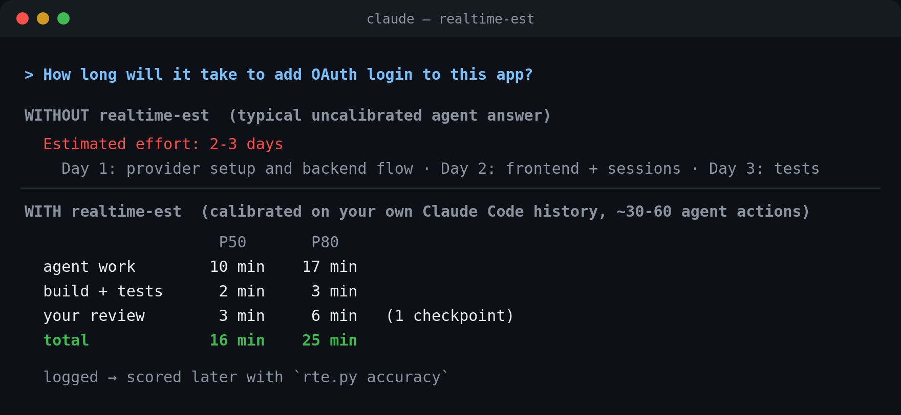

# realtime-est

**Realistic time estimates for AI-agent work, calibrated on your own Claude Code history.**

A Claude Code plugin (skill + hook) that stops your agent from quoting human timelines
("this will take 2-3 days") for work it finishes in 15 minutes.



<sub>The "without" answer illustrates the typical failure mode; the "with" numbers come from a real
`estimate` run on the author's history.</sub>

## The problem

LLMs learned how long things take from human-written text. When an agent estimates a task,
it gives the human reference class: hours for a feature, days for a refactor. Then it does
the work in minutes. Measurements put pre-task agent estimates at
[4-7x too long](https://arxiv.org/html/2604.00010v1), and practitioners report gaps of
[one to three orders of magnitude](https://www.monperrus.net/martin/coding-agents-sense-of-time).
The model also has no clock, so it cannot notice on its own how long its turns take.

A generic "divide by 10" rule does not fix this. The real speed depends on your model,
effort setting, machine, codebase and how you work.

## How it works

1. **Measure.** A `Stop` hook records every finished turn: active time, wall-clock time,
   number of tool calls (*agent actions*), files edited, time spent in long-running commands,
   and time spent waiting for you. Your existing transcripts in `~/.claude/projects` are
   imported too, so calibration works from day one. Measured active time matches Claude Code's
   own internal turn timer within ~2% for most turns of the author's history.
2. **Estimate in actions, not minutes.** The skill makes Claude break the task into steps
   and estimate the **number of tool calls**, a quantity the model can reason about. It
   also lists wall-clock-bound work (builds, training, CI) and the number of times you need
   to review or answer.
3. **Convert with your data.** A log-log regression `time = c · actions^b`, fitted on your
   turns, plus a Monte Carlo over the range of actions and the empirical residuals gives
   P10/P50/P80/P90.
4. **Three clocks, reported separately:** agent work, compute/waits, and your time.
5. **Close the loop.** Estimates are logged and later scored against what actually happened
   (`accuracy`). A multi-turn task (`--scope task`) stays open until `done`. It is then
   scored against every turn in the project since the estimate, across sessions. Once there are at least 5 scored estimates, a systematic over- or
   under-counting of actions is corrected automatically.

Example output (from the author's history: 44 tool-using turns, Opus 5.5):

```
$ rte.py estimate --actions 14-28 --compute-min 0.1-0.5 --checkpoints 1
Calibrated estimate for 14-28 agent actions
Model: your history (n=44)
                      P10      P50      P80      P90
      agent work   2.5min   5.2min   8.7min    13min
   compute/waits       8s      18s      25s      28s
   you (1 chkpt)      25s   2.6min   6.2min   7.7min
TOTAL wall-clock   4.4min   8.9min    15min    21min
```

```
$ rte.py profile
History: 45 turns (44 with tool use, 1 chat-only), 2026-10-24 .. 2026-11-02
Models:  claude-opus-5-5 (44)

Agent time by size (core = active time minus long-running commands and waiting for you)
   actions  turns  core P50  core P80  wall P50  wall P80 files P50
       1-5     14       43s    1.4min       43s    1.7min         0
      6-15      8    3.6min    5.8min    5.7min     16min         1
     16-40      7    5.5min    8.9min     12min      2.7h         2
    41-100      5     16min     24min     35min      2.4h         5
   101-250      8     37min     45min      1.0h      9.6h        14
      251+      2      1.5h      1.8h     10.6h     15.3h        22

Seconds per agent action: P50 13.9s, P80 22.3s
Fit: core_s = 23.8 * actions^0.88  (n=44, your history)
Your review/response time between turns: P50 1.5min, P80 4.5min (n=33)
```

In the table, the gap between `core` and `wall` time for large tasks comes from
long-running training jobs. That is why compute is a separate clock.

## Installation

Requirements: Claude Code and `python3` (3.8+). There are no other dependencies.

### Option A: plugin (recommended)

Inside Claude Code:

```
/plugin marketplace add TomAsh97e/realtime-est
/plugin install realtime-est@realtime-est
```

Restart Claude Code. The skill `realtime-est` and the `Stop` hook are now active in every
project.

### Option B: manual install

```bash
git clone https://github.com/TomAsh97e/realtime-est.git
cd realtime-est
./install.sh
```

This copies the skill to `~/.claude/skills/realtime-est` and adds the hook to
`~/.claude/settings.json`. A backup is saved as `settings.json.bak-realtime-est`. It also
imports your history and prints your profile.

To remove: `./install.sh --uninstall`. Your recorded data in `~/.claude/realtime-est/` is
kept.

### Optional: make it automatic

The skill triggers on questions like "how long will this take?". To also catch durations
that Claude writes into plans unprompted, add this to your `~/.claude/CLAUDE.md`:

```markdown
Never state a duration, ETA or timeline from intuition. Use the realtime-est skill first.
```

## Usage

Just ask, in any language:

- "How long will it take to add OAuth to this app?"
- "Ile zajmie migracja tego modułu na async?"
- "Plan the next 3 milestones with time estimates."

Claude loads the skill, checks your profile, looks up similar past tasks, counts the actions,
runs `estimate`, reports the result and logs the estimate.

### CLI reference

The script lives at `skills/realtime-est/scripts/rte.py` (plugin) or
`~/.claude/skills/realtime-est/scripts/rte.py` (manual install). You can run it yourself:

| Command | What it does |
|---|---|
| `rte.py profile [--project DIR] [--json]` | Your calibration: time by task size, seconds per action, review time |
| `rte.py similar "task description"` | Past turns most similar to a task, with their real action counts and durations |
| `rte.py estimate --actions 20-40 [--compute-min 5-10] [--checkpoints 2] [--json]` | Calibrated P10/P50/P80/P90 |
| `rte.py log-estimate --p50 S --p80 S --actions LO-HI --naive S --scope current\|task --desc "..."` | Record an estimate. `current` covers the rest of this turn; `task` covers multi-turn work until `done` |
| `rte.py done [--id ID]` | Close the latest open task estimate here and score it immediately |
| `rte.py accuracy` | Logged estimates vs reality, P80 coverage, and how far off the naive guesses were |
| `rte.py backfill` | Import transcripts (every other command runs this automatically) |
| `rte.py hook` | The `Stop` hook entry point (reads hook JSON on stdin; never prints, never fails) |

### What is measured

| Field | Meaning |
|---|---|
| `wall_s` | From your prompt to the last event of the turn, including background jobs the agent waited for |
| `active_s` | Time the agent was actually busy (idle gaps while waiting for background notifications are excluded) |
| `core_s` | `active_s` minus single tool calls longer than 60 s (builds, training) and minus time spent waiting for your answers. This is what the action-count model is fitted on |
| `actions` | Tool calls in the turn |
| review gap | Time between the end of a turn and your next prompt (gaps over 30 min count as breaks and are ignored) |

## Data and privacy

Everything stays on your machine, in `~/.claude/realtime-est/`:

- `turns.jsonl`: one record per turn, with timings, tool counts, model, project path, and
  the **first 400 characters of your prompt** (used by `similar`)
- `estimates.jsonl`: logged estimates
- `backfill_index.json`: which transcripts have already been imported

Nothing is sent anywhere. Set `RTE_HOME` to use a different directory. Claude Code deletes
old transcripts after `cleanupPeriodDays` (30 by default); the hook keeps your compact
records after that.

## Limitations

- **Cold start.** With fewer than 15 tool-using turns, a generic prior is used and the
  output says so.
- **Action counts are still the model's guess.** They are a much better quantity to guess
  than minutes, and the bias is corrected once estimates are scored. A task that turns
  into a deep debugging session can still blow past P90.
- **Model and setting drift.** A new model or a different effort level changes speed.
  `profile --project` narrows the data to one project. After a big model change, consider
  starting fresh with a new `RTE_HOME`.
- **Calendar time is out of scope.** Your availability, waiting for teammates and meetings
  are not modeled. The skill reports your review time per checkpoint; the rest is up to you.
- Transcript parsing relies on Claude Code's JSONL format, which is not a public API. The
  parser is defensive, but a format change may require an update.

## Related work

- [agent-estimate](https://pypi.org/project/agent-estimate/): PERT estimates with fixed
  per-model calibration
- [OpenTime](https://syntheticcognitionlabs.github.io/OpenTime/): an MCP server where the
  agent builds its own task-time database
- [METR time horizons](https://metr.org/): how long a task (in human time) agents can
  complete
- [Coding agents' sense of time](https://www.monperrus.net/martin/coding-agents-sense-of-time):
  the "anthropocentric time bias"

How realtime-est differs: it calibrates on your own transcripts with zero setup, estimates
in agent actions rather than minutes, keeps the three clocks separate, and scores its own
estimates.

## Development

```bash
python3 -m unittest discover -s tests
claude plugin validate .
```

## License

MIT
